# BarrierLab

**One rule set for web audits.** Accessibility rules (WCAG 2.2), HTML conformance, perception
and web checks as pure-Rust libraries, with the accessibility rules also shipped as
WebAssembly. A finding means the same thing whether the page was checked at build time, in a
terminal audit or live in the browser.

[](LICENSE)
[](https://crates.io/crates/a11y-rules)
[](https://www.npmjs.com/package/@casoon/a11y-wasm)

<p align="center">
  
</p>

**This repository contains libraries only.** The tools that use them live in their own
repositories and pull the packages from crates.io and npm.

## What it gives you

- **One finding model.** Every package reports through `a11y-report`: rule ID, outcome,
  severity, WCAG criteria, location, stable JSON.
- **Pure libraries, no browser.** A package takes data and computes. It never opens a page,
  fetches a URL or speaks CDP.
- **"Did not run" is not "passed".** A rule whose prerequisite is missing appears as `NotRun`
  with a reason, never as a silent success.
- **Dependencies point down.** Four layers, no cycles, no host code in the repository.

20 crates on crates.io, four layers:

| Layer | Crates |
|---|---|
| **L0** parsers | `html5-parser` · `css-tokenize` · `csp-parse` · `media-query-parse` · `xpath-eval` · `relax-ng` · `schematron-engine` |
| **L1** models | `a11y-dom` · `a11y-report` · `stylesheet-parse` · `html-conform` · `xml-adapters` |
| **L2** computation | `accname` · `style-cascade` · `a11y-rules` · `a11y-static` · `a11y-perception` · `web-checks` |
| **L3** delivery | `a11y-wasm` (crate and npm `@casoon/a11y-wasm`) · `html-conform-wasm` (crate and npm `@casoon/html-conform-wasm`) |

## A first look

```rust
use a11y_dom::Arena;
use a11y_rules::run;

let doc = Arena::builder()
    .open("html").open("body")
        .open("img").attr("src", "logo.png").close()
    .close().close()
    .build();

let report = run(&doc);
assert!(report.findings.iter().any(|f| f.rule_id == "images/alt-missing"));
```

Rules that need more than structure (names, styles, rendering) are in the report as `NotRun`
until the host supplies it. More examples, the report format and the HTML conformance check
are in the documentation.

## Documentation

**<https://casoon.github.io/barrierlab/>**: [testing a website](https://casoon.github.io/barrierlab/docs/testing/)
with the tools built on it (strengths and limits included), package pages, the accessibility guide, the
html-conform guide (including the [comparison with the Nu Html Checker](https://casoon.github.io/barrierlab/docs/html-conform/guides/vnu-comparison/)),
rule reference and releases.

## Built on this

[auditmysite](https://github.com/casoon/auditmysite) (terminal audit),
[astro-post-audit](https://github.com/casoon/astro-post-audit) (after the Astro build),
[liveaudit](https://github.com/casoon/liveaudit) (in the live page),
[barrierlab-cli](https://github.com/casoon/barrierlab-cli) and the
[Claude Code plugin](https://github.com/casoon/barrierlab-agent-plugin),
[html-conform-lsp](https://github.com/casoon/html-conform-lsp) (language server prototype).

## Status

The library set is feature-complete for now and in maintenance: bug fixes, no new features
until the tools above have taken it up. Issues are welcome and collected.

## BarrierLab.eu

Part of the wider BarrierLab project, an independent European laboratory for digital
accessibility. Articles, tools and background: **<https://barrierlab.eu>**.

## License

MIT
