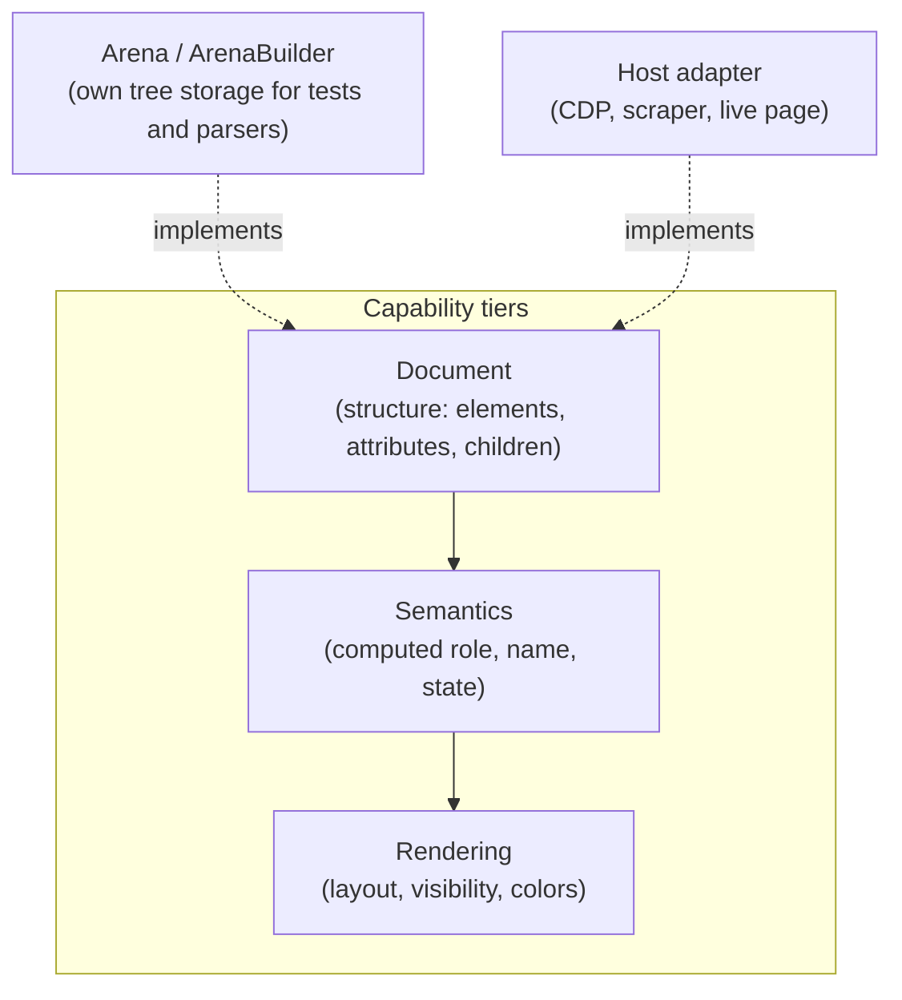

The abstraction over the document: a DOM-shaped tree as a trait, plus
capability tiers. This lets the same rule run over a parsed HTML tree,
over a browser AX tree and over the live page.

## Status

0.26.0 on crates.io. Used by `accname`, `a11y-rules` and all hosts;
auditmysite builds a tree from CDP data out of it in `dom_document.rs`.

## Structure

## Public surface

| Type | Purpose |
|---|---|
| `Document` | the minimum: tree, elements, attributes |
| `Semantics`, `Rendering` | tiers a host offers only if it really has the data |
| `Rendering` host measurements | default methods, `None` = not measured: `layout`, `scroll_overflow_px`, `visually_hidden`, `sampled_backdrop`, `frame_reachable` (#132), `box_transform` (#134), `paste_probe` (#133), `focus_cover` (#135) |
| `BoxTransform` | computed `transform` and `rotate` of an element as strings, via `Rendering::box_transform()` (default `None`); a method instead of two `ComputedStyle` fields because new fields on that non-`non_exhaustive` struct break hosts that build it as a literal |
| `PasteProbe` | raw observations of a synthetic paste event at a password or code field (`cancelled`, `inserted`), via `Rendering::paste_probe()` (default `None`); the host runs it as an opt-in pass because it executes page handlers and writes `value` |
| `FocusCover` | after the host focused and scrolled a control: sample `points`, how many are `covered` by a fixed or sticky foreign element painted above it, and the `blocker`; via `Rendering::focus_cover()` (default `None`); the host records how it scrolled |
| `Layout` | layout information for heuristic rules, via `Rendering::layout()` (default `None`) |
| `Arena`, `ArenaBuilder`, `ArenaNode` | ready-made implementation for tests and parser-based hosts |

## Parse tree adapter

With the optional feature `html5-parser`, `html5_parser::Document` itself
implements `Document` (handle type `Html5Node`), so a host can run rules
over the parse tree without copying it into an `Arena`. Comments and
doctype are skipped, `<template>` content appears as children of the
`<template>` element, and `document_order` walks the tree because the
parser's node ids follow allocation order. The feature is off by default.

## Dependencies

Downward: nothing except `serde` (optional). Upward: `accname`,
`a11y-rules`, host adapters.

## Limits

A tier is a promise about **availability**, not about quality. A host that
offers `Rendering` promises layout data — not that it is correct. If a tier
is missing, the rules built on it return `NotRun`, not "passed".
