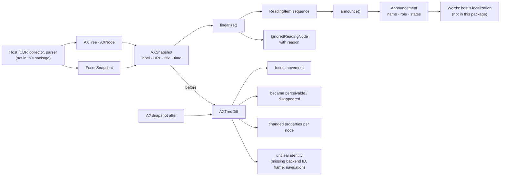

What of a page is **perceivable**: a snapshot, its reading order and
the difference between two snapshots. The package computes, it does not collect.

## Status

0.2.1. Extracted from auditmysite
(`accessibility/{tree,diff,snapshot}.rs`, `screen_reader/{linearizer,types}.rs`)
after the rework that was measured on 133 pages with 692 journey instances.
27 tests came along and run without a browser.

New in 0.2.0 is the **announcement structure** (`announce`). The renderer from
auditmysite's `announcer.rs` could not be separated from it, because it handled structure and
words in one go: which parts an announcement has, in which
order, and which state adds nothing — and right next to it, what that is called
in German. The first half is the same everywhere and now lives here;
the second stays with the host, which brings its own localization.

## Structure

## Public surface

| Entry | Purpose |
|---|---|
| `AXTree`, `AXNode`, `AXValue`, `AXProperty` | the tree and its nodes; `node_by_backend_id`, `is_within` for containment |
| `AXSnapshot`, `FocusSnapshot`, `FocusIndicatorStatus`, `Rect` | one captured point in time including focus position |
| `AXTreeDiff` | the difference between two snapshots |
| `linearize`, `ReadingItem`, `IgnoredReadingNode` | the projection into reading order, with what it skips |
| `announce`, `Announcement`, `AnnouncedRole`, `AnnouncedState` | what the announcement of a reading unit consists of — named parts, not a string |

## Dependencies

Downward: only `serde`. Upward: auditmysite, Relief.
Deliberately **not** `a11y-report`: this package produces no findings.

## Limits

Three things the measurement taught, which apply here as rules:

1. **"Added" means became perceivable.** Chrome does not remove a hidden
   node — it stays with the same backend ID as `ignored`
   with reason `notRendered`. Defined by presence, the diff missed the
   most common way of opening up content.
2. **Identity via the backend ID, not via position.** Comparing positions
   across two arrays was one of the three reasons why 44% of the high findings
   of a JavaScript probe were wrong.
3. **Unclear identity is reported, not guessed.** Missing backend ID,
   node replacement, frame change, navigation.

And the limit of the method itself: the diff does not prove an announcement. Transient
changes between two snapshots need an event trace from a host — in the
originating project that is `interaction::live_regions`, and that is collection, so
not here.
