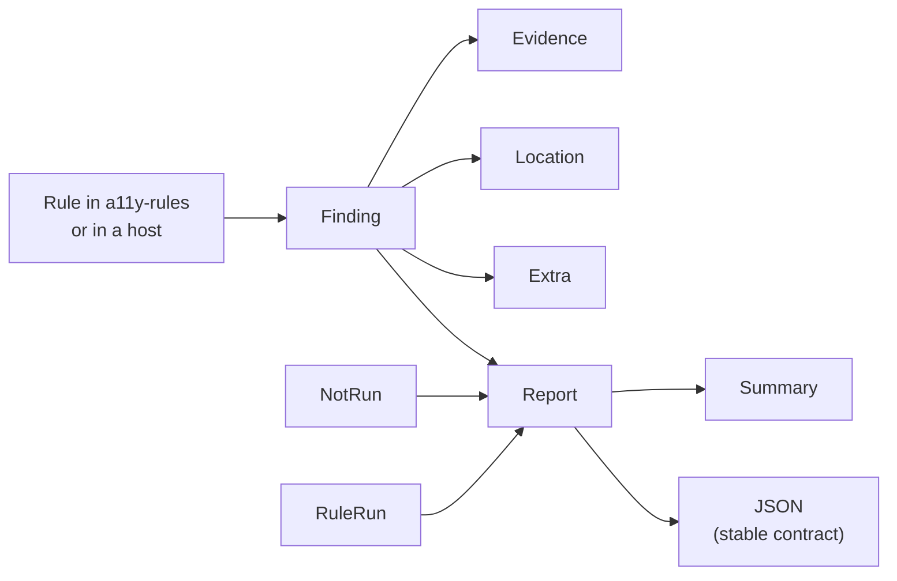

The finding model all tools share: four outcome states, severity,
WCAG mapping and a stable JSON contract. It evaluates nothing itself.

## Status

0.26.0 on crates.io. Used by auditmysite, astro-post-audit and liveaudit —
the first package that is really in use everywhere.

## Structure

## Public surface

| Type | Purpose |
|---|---|
| `Outcome` | the four states; `NotRun` is one of them, not a special case of "passed" |
| `Severity`, `WcagLevel` | classification of a finding |
| `Finding`, `Evidence`, `Location` | a finding and what it is anchored to |
| `Report`, `RuleRun`, `NotRun`, `Summary` | what a run produced, including the rules that did not run |
| `Extra` | host-specific additional fields, without breaking the contract |
| `FindingId`, `RootCauseId`, `normalize_selector` | stable identifier of a finding (rule + element pattern) and of a cause, the same across pages and across runs |
| `CauseConfidence`, `ImpactArea`, `EvidenceBasis` | how well a shared cause and an impact are supported |
| `CriterionState` | state of an assessment criterion; "not detected" is not "not met"

## Dependencies

Downward: only `serde`. Upward: `a11y-rules`, `a11y-perception` (planned),
all hosts.

## Limits

The model says nothing about how a finding was found and whether the
measurement was suitable. Anyone who supplies no evidence gets a finding without
evidence — the model does not enforce it.
