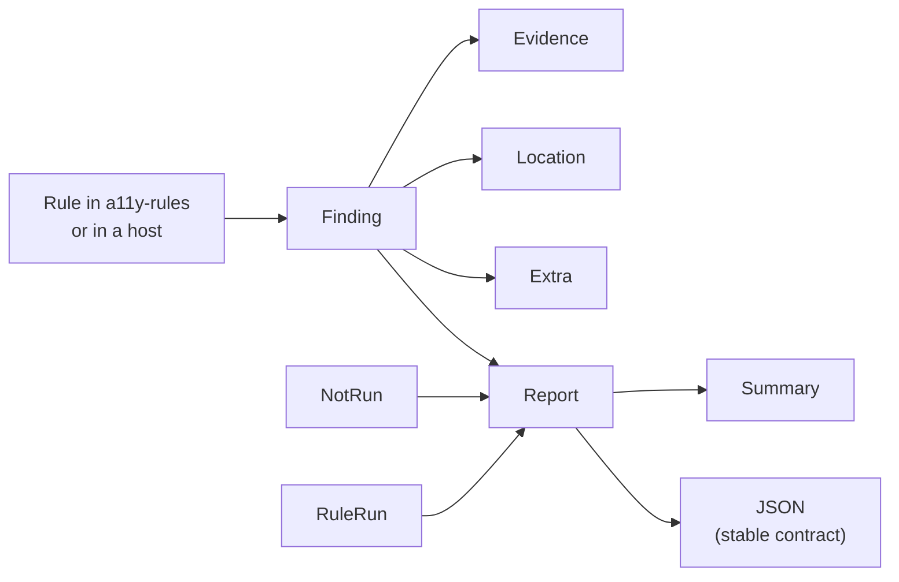

The finding model all tools share: four outcome states, severity,
WCAG mapping and a stable JSON contract. It evaluates nothing itself.

## Status

0.26.0 on crates.io. Used by auditmysite, astro-post-audit and liveaudit —
the first package that is really in use everywhere.

## Structure

## Public surface

| Type | Purpose |
|---|---|
| `Outcome` | the four states; `NotRun` is one of them, not a special case of "passed" |
| `Basis` | criterion or recommendation: a best-practice finding (`Finding::best_practice`) is `REVIEW` with `Basis::BestPractice`, never a WCAG failure |
| `Severity`, `WcagLevel` | classification of a finding |
| `Finding`, `Evidence`, `Location`, `SourcePosition` | a finding and what it is anchored to; `Location::end` is the exclusive end of a source range, `Finding::id()` the stable id (selector, else file and start position) |
| `Report`, `RuleRun`, `NotRun`, `Summary` | what a run produced, including the rules that did not run |
| `InputNote`, `InputKind` | `Report::inputs`: the host notes that an input was incomplete (stylesheet unavailable or unresolved, partial document). Rules do not read these notes; with `stylesheet_unavailable` present, treat the contrast rules as untested |
| `Extra` | host-specific additional fields, without breaking the contract |
| `FindingId`, `RootCauseId`, `normalize_selector` | stable identifier of a finding (rule + element pattern) and of a cause, the same across pages and across runs |
| `CauseConfidence`, `ImpactArea`, `EvidenceBasis` | how well a shared cause and an impact are supported |
| `CriterionState` | state of an assessment criterion; "not detected" is not "not met"

### Extensibility decisions

- `Report`, `Finding`, `RuleRun`, `Summary`, `Evidence`, `Location`, `InputNote`, `NotRun` (and `Meta` in `a11y-rules`) are `#[non_exhaustive]`: the crate produces them, hosts only read or build them through constructors, so new fields are not breaking.
- `Outcome`, `Severity` and `WcagLevel` stay exhaustive: they are closed vocabularies, and a new member would change what a verdict means, so a `match` that breaks is the intended signal.
- The host-input types `ComputedStyle`, `Layout`, `Rect`, `Color` and `Backdrop` stay exhaustive: hosts fill them completely, and a field added silently would be left at a default instead of being supplied.
- `SourcePosition` stays exhaustive: line, column and byte offset are the complete position a parser reports, and the producer fills all three.
- `Evidence::source` stays a free string: the set of sources is open (`ax_tree`, `dom_attribute`, `computed`, `meta`, `http_header`, and what hosts add), it is part of the JSON contract, and an enum would need an `Other(String)` escape that gives no more safety than the string.

## Dependencies

Downward: only `serde`. Upward: `a11y-rules`, `a11y-perception` (planned),
all hosts.

## Limits

The model says nothing about how a finding was found and whether the
measurement was suitable. Anyone who supplies no evidence gets a finding without
evidence — the model does not enforce it.
