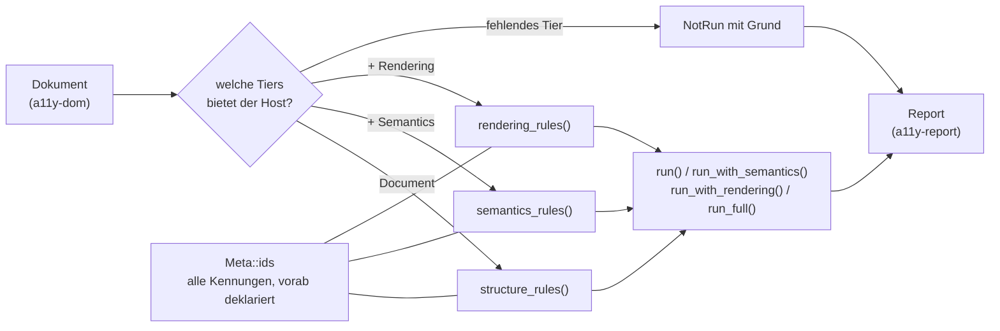

Der Regelbestand, generisch über `a11y-dom`: eine Implementierung für
Build-Zeit, CI und laufende Seite. Ergebnis ist immer ein `Report` aus
`a11y-report`.

## Stand

0.26.0 auf crates.io. Benutzt von auditmysite (`wcag/shared.rs` ruft
`run_with_semantics`), astro-post-audit und liveaudit. Die Kennungen sind über
alle Oberflächen stabil und in `Meta::ids` deklariert: 94 in Tier 1 (Struktur),
35 in Tier 2 (Semantik), 17 in Tier 3 (Darstellung), 5 über Stylesheets. Die
vollständige Liste steht in der [Regelreferenz](../a11y/reference/regeln.mdx).

## Aufbau

## Öffentliche Fläche

| Eintrag | Zweck |
|---|---|
| `run`, `run_with_semantics`, `run_with_rendering`, `run_full` | ein Lauf, je nach vorhandenen Tiers |
| `run_stylesheets` | ergänzt einen Bericht um die Regeln über Stylesheets (`stylesheet-parse`) |
| `structure_rules`, `semantics_rules`, `rendering_rules` | die Regeln einzeln, wenn ein Host selbst orchestriert |
| `structure_metas`, `semantics_metas`, `rendering_metas`, `stylesheet_metas` | alle Kennungen vorab, ohne zu laufen — für Abdeckungsberichte |
| `Meta`, `StructureRule`, `SemanticsRule`, `RenderingRule`, `StylesheetRule` | Regeltypen und ihre Deklaration |
| `Scope` | welche Knoten eine Regel sieht: Accessibility-Tree, Dargestelltes oder das ganze Markup |

Zwei Regelgruppen urteilen bewusst nicht: die **Checkliste** (`manual/*`,
`UNTESTED` je Seite und Kriterium, sobald es auf der Seite anwendbar ist) und
die **Heuristiken** in Tier 3 (`REVIEW`, aus `Rendering::layout` und
`bounds`; ohne diese Daten melden sie nichts, nur die ungemessene
Fokus-Sichtbarkeit bleibt als `UNTESTED` stehen).

## Normative Zuordnung

Ein Befund mit WCAG-Kriterium und `FAIL` behauptet einen Verstoß. Das darf er
nur, wenn das Markup ihn belegt. Belegt eine Regel nur eine Empfehlung, trägt
der Befund das Schlagwort `best-practice` und kein Kriterium; belegt sie eine
Vermutung, die erst ein Prüfer entscheidet, ist er `REVIEW`. Maßstab sind WCAG
2.2 mit Understanding und Techniken (Fxx sind Fehlertechniken, alles andere
nur hinreichend), die ACT-Regeln des W3C und als Vergleich axe-core.

Geprüft wurden alle `FAIL`-Befunde mit Kriterium (Stand 0.26.0,
auditmysite#779):

| Regel | Entscheidung | Begründung |
|---|---|---|
| `headings/h1-missing` | Best Practice | Eine h2 ist als Überschrift bestimmbar (1.3.1); WCAG verlangt keine Ebene. axe `page-has-heading-one` ist Best Practice. |
| `headings/skip-level` | Best Practice | 1.3.1 verlangt bestimmbare, nicht lückenlose Ebenen; G141 ist hinreichend, nicht Pflicht. axe `heading-order` ist Best Practice. |
| `headings/none` | 2.4.1 nur ohne jeden Mechanismus | Überschriften (H69), main-Landmark (ARIA11) und Sprunglink (G1) reichen je allein. Fehlen alle drei: `FAIL`, wenn Navigation oder Kopfbereich als Landmark ausgezeichnet sind, sonst `REVIEW` — ob Blöcke sich über Seiten wiederholen, zeigt ein Dokument nicht. |
| `landmarks/main-missing`, `landmarks/main-duplicate` | Best Practice | 1.3.1 verlangt keine Landmarks, 2.4.1 ist auch über Überschriften oder Sprunglink erfüllt. Mehrere `<main>` verbietet HTML, nicht WCAG (4.1.1 ist entfallen). |
| `landmarks/not-top-level`, `landmarks/banner-duplicate`, `landmarks/contentinfo-duplicate`, `landmarks/content-outside` | Best Practice | Wie axe `landmark-*-is-top-level`, `landmark-no-duplicate-*`, `region`; kein Kriterium verlangt Landmarks. |
| `zoom/viewport-missing` | Best Practice | Ohne Angabe bleibt Zoomen erlaubt (1.4.4); 1.4.10 wird über die Vergrößerung im Browser geprüft, die die Angabe nicht berührt. |
| `aria/role-redundant`, `lists/role-redundant` | Best Practice | Die Rolle stimmt; 4.1.2 ist erfüllt. ARIA in HTML rät nur ab. |
| `patterns/tooltip-unreferenced` | Best Practice | 1.4.13 regelt Erscheinen und Verschwinden bei Hover und Fokus, nicht die Verknüpfung. |
| `lists/empty` | Best Practice | Eine leere Liste unterschlägt keine Information. |
| `tables/header-missing` | `REVIEW` | F91 trifft nur Datentabellen mit sichtbaren Köpfen; ob eine vorliegt, zeigt das Markup nicht. |
| `keyboard/positive-tabindex` | `REVIEW` | F44 verlangt ein Urteil, ob die entstehende Reihenfolge Sinn und Bedienung bricht. axe `tabindex` ist Best Practice. |
| `ids/duplicate` | `REVIEW` | Der Browser löst auf das erste Element auf; ob das gemeint ist, sagt das Markup nicht. |
| `keyboard/click-handler-not-focusable` | `REVIEW`, wenn ein per Tab erreichbares Element darin steckt | Der Handler fängt dann meist nur dessen Klick ab (Karte um ihren Link). Ohne ein solches Element bleibt es ein Verstoß gegen 2.1.1. |
| `links/used-as-button` | `REVIEW` | Ob der Handler doch navigiert, zeigt das Markup nicht. |
| `images/server-side-map` | `REVIEW`, 2.1.1 statt 1.1.1 | Das Problem ist die Bedienung per Tastatur (axe: 2.1.1); gleichwertige Textlinks daneben erfüllen sie. |
| `frames/name-missing` | 4.1.2, ohne 2.4.1 | ACT cae760 führt nur 4.1.2; für 2.4.1 ist der Titel eine Technik unter mehreren (H64). |
| `svg/name-missing` | `FAIL` nur mit Bildrolle, sonst `REVIEW` | ACT 7d6734 gilt nur für SVG mit ausdrücklicher Rolle `img` oder `graphics-*`; ein SVG ohne Rolle kann Schmuck sein. |
| `forms/label-missing`, `forms/placeholder-as-label` | Platzhalter allein: kein `label-missing`, sondern `REVIEW` | Der Platzhalter stiftet den Namen (HTML-AAM, ACT e086e5 besteht) und ist sichtbar, solange das Feld leer ist. |
| `forms/error-unidentified` | `REVIEW` | Eine sichtbare Fehlermeldung neben dem Feld erfüllt 3.3.1 auch ohne Verknüpfung (G83). |
| `forms/group-missing`, `forms/group-name-missing` | `REVIEW` | `fieldset` ist hinreichend (H71), nicht Pflicht; ein `fieldset` kann auch nur gestalten. |
| `forms/no-submit` | `REVIEW` | 3.2.2 verletzt erst ein Kontextwechsel bei der Eingabe, nicht der fehlende Knopf (H32 ist hinreichend). |
| `dialog/focusable-missing` | `REVIEW` | Der Dialog selbst kann den Fokus tragen (`tabindex="-1"`), Escape kann ihn schließen. |

Unverändert `FAIL` mit Kriterium, weil eine ACT-Regel oder Fehlertechnik den
Befund trägt: `images/alt-missing`, `images/area-alt-missing`,
`images/input-alt-missing`, `objects/alt-missing` (1.1.1);
`links/name-missing`, `buttons/name-missing`, `summary/name-missing`,
`dialog/name-missing`, `names/required-missing` (4.1.2, ARIA „Name
Required"); `document/lang-missing`, `document/lang-invalid`,
`document/lang-mismatch` (3.1.1, ACT b5c3f8, bf051a, 5b7ae0);
`document/title-*` (2.4.2, ACT 2779a5); `zoom/viewport-locked` (1.4.4, ACT
b4f0c3); `timing/meta-refresh` (2.2.1, ACT bc659a); `headings/empty` (ACT
ffd0e9); `aria/*` und `popover/*` (4.1.2, ACT 5c01ea, 6a7281, 4e8ab6; Kontext
und Bestandteile 1.3.1, ACT ff89c9, bc4a75); `keyboard/hidden-focusable` (ACT
6cfa84); `keyboard/scrollable-region-not-focusable` (2.1.1, ACT 0ssw9k);
`inert/dialog-inert` (offenes `<dialog>`); `context/on-input` (F37 mit Beleg
im Handler; `REVIEW` mit Beschreibung am Feld, G13); `lists/invalid-structure`, `lists/item-outside-list`,
`lists/term-without-definition`, `tables/header-without-data`,
`tables/headers-attr-invalid`, `tables/presentational-with-headers` (1.3.1,
F46, ACT d0f69e, a25f45); `forms/label-missing` ohne jeden Namen (ACT e086e5);
`forms/autocomplete-invalid` (1.3.5, ACT 73f2c2); `label-in-name/mismatch`
(2.5.3, ACT 2ee8b8); `contrast/*` (gemessen); `color/link-indistinct` (F73,
gemessen; `REVIEW`, wenn die Linkfarbe 3:1 zum Text erreicht, G183); `focus/outline-removed` (F78, seitenweit ohne Ersatz);
`status/live-overridden` mit `aria-live="off"` (4.1.3).

Die `viz/*`- und `display/*`-Regeln der Darstellungskonvention tragen
`best-practice` und zugleich das nächste Kriterium (siehe unten); sie melden
nur auf Seiten, die die Konvention benutzen. Diese Doppelung ist dort
beabsichtigt und hier nicht geändert.

## ARIA nach WAI-ARIA 1.2

Die `aria/*`-Regeln prüfen Attributnamen, Wertebereiche, erlaubte und
verbotene Attribute je Rolle sowie Kontext und Bestandteile. Die Tabellen dazu
sind aus der Spezifikation erzeugt (eine Bitmaske je Rolle). Kontext und
Bestandteile laufen über das DOM, nicht über den Accessibility-Tree: Ein `<li>`
in einer Liste mit fremder Rolle zählt als `listitem`, auch wo Chrome es
glättet (auditmysite#715). Native Tabellen und Listen ohne `role` prüfen die
`tables/*`- und `lists/*`-Regeln.

## Namen

Neben `links/`, `buttons/`, `svg/` und `tables/name-missing` prüfen
`dialog/name-missing`, `summary/name-missing` und `names/required-missing`
die Rollen, für die WAI-ARIA 1.2 einen Namen verlangt. `label-in-name/mismatch`
vergleicht nach WCAG 2.5.3 den Namen mit dem sichtbaren Text,
`status/live-overridden` die `aria-live`-Angabe von Live-Regionen mit der
Vorgabe ihrer Rolle.

## Formulare

`forms/*` prüft Beschriftung, Gruppen, Fehlerbeschreibung (`aria-invalid`),
Autofill-Angaben nach dem HTML-Standard, Absende-Elemente und wiederholte
Eingaben; `context/*` den Kontextwechsel bei Fokus und Eingabe (3.2.1,
3.2.2), `auth/captcha` ein Captcha im Anmeldeformular (3.3.8). Was nur aus
Wortlaut oder Handlern geraten werden kann — Zweck eines Felds, Formatvorgabe,
Pflichtkennzeichnung, Wiederholung, Captcha —, ist `REVIEW`. Der Einfüge-Test
an Passwortfeldern und das Lesen von Handlern über `window` bleiben im Host.

## Darstellungskonvention

`viz/*` und `display/*` prüfen die statische Hälfte der
[Darstellungskonvention](../a11y/concepts/darstellungsmodi.md) (Entwurf v0,
casoon/barrierlab#22): `figure[data-viz]` mit Text-, Standbild- und
Live-Schicht, `html[data-display]` mit Umschalter. Die Regeln stehen hier und
nicht in `web-checks`, weil sie den DOM brauchen; sie sind Tier 1. Sie melden
nur auf Seiten, die die Konvention benutzen, tragen das Schlagwort
`best-practice` und hängen am nächsten WCAG-Kriterium. Was erst die laufende
Seite zeigt — berechnete Sichtbarkeit, der Zeitpunkt von `data-display`, der
Textmodus —, misst auditmysite.

## Stylesheets

Fünf Regeln lesen die Stylesheets der Seite: `focus/outline-removed` (2.4.7),
`motion/reduced-motion-ignored` (2.3.3), `orientation/content-hidden` (1.3.4),
`text/justified` und `text/line-height-tight` (1.4.8). Der Host gibt den
CSS-Text jedes Sheets an `stylesheet_parse::parse_stylesheet` und den Bericht eines
`run_*` an `run_stylesheets`; ohne diesen Schritt stehen die fünf mit
`NotRun::CapabilityMissing` im Bericht. Woher der Text kommt, ist Sache des
Hosts: aus `document.styleSheets` im Browser oder aus den Dateien eines Builds.

Ob eine Regel auf dieser Seite gilt, entscheidet ein eigener Selektor-Abgleich
gegen das Dokument (Teilmenge von Selectors Level 4; Zustände und
Pseudo-Elemente gelten als erfüllt, Unbekanntes wie `:has()` als möglicher
Treffer). Keine Kaskade mit Spezifität: Für den Fließtext zählt die letzte
treffende Angabe am Absatz, sonst am nächsten Vorfahren.

## Abhängigkeiten

Nach unten: `a11y-dom`, `a11y-report`, `accname`, `stylesheet-parse`. Nach oben: alle Hosts,
künftig `a11y-wasm`.

## Geltungsbereich

Jede Regel deklariert in `Meta::scope`, welche Knoten sie sieht, und läuft über
eine Sicht auf das Dokument, in der die übrigen fehlen:

| `Scope` | fehlt in der Sicht | Regeln |
|---|---|---|
| `AccessibilityTree` | `aria-hidden="true"`, nicht Dargestelltes | der Normalfall |
| `Rendered` | nicht Dargestelltes | `keyboard/positive-tabindex`, `keyboard/hidden-focusable`, `keyboard/click-handler-not-focusable`, Kontrast, die Checkliste `manual/*` |
| `Markup` | nichts | Dokumentweites, `aria/reference-missing`, `ids/duplicate`, `popover/*`, `patterns/tooltip-unreferenced`, `media/audio-autoplay`, `viz/*` und `display/*` (`viz/*` übergeht Figuren unter `hidden`) |

„Nicht dargestellt" heißt mit Tier 3 `display: none` oder `visibility: hidden`,
ohne das `hidden`-Attribut. Ohne Stile bleibt per CSS Verstecktes in der Sicht
— die ehrliche Grenze des statischen Falls. `visibility` kann an einem
Nachfahren wieder `visible` sein; ein solcher Nachfahre fällt mit weg.

## Regelkorpus und Mutationen

Jede Kennung aus `Meta::ids` hat in `tests/korpus/` direkte Fälle: einen
Treffer mit genau dem erwarteten Ergebnis (ein `FAIL` erfüllt keinen
`REVIEW`-Fall), ein ähnlich aussehendes konformes Gegenbeispiel und ein
Dokument, auf das die Regel nicht anwendbar ist; bei den beiden letzten muss
die Kennung nachweislich gelaufen sein. Dazu Grenzfälle beidseits jeder
Schwelle und die für die Regel relevanten Varianten (versteckt, nativ/ARIA,
andere Beschriftungswege, Shadow DOM). Jeder Fall nennt die Norm, aus der
seine Erwartung stammt. Der Korpus-Host bedient alle Tiers aus dem HTML des
Falls: Stile aus dem `style`-Attribut, Geometrie über eigene Eigenschaften,
Stylesheets aus `<style>`.

`tests/mutations/*.toml` nennt je Kennung mindestens eine gezielte Mutation
(Bedingung umkehren, Schwelle verschieben, Befund unterdrücken), die ein Fall
töten muss. `xtask/mutate.py crates/a11y-rules` wendet sie nacheinander im
Arbeitsbaum an, baut, lässt die Fälle der Kennung laufen und stellt die Datei
wieder her. Zwei Gates in `cargo test` scheitern, sobald einer Kennung eine
Fallart oder eine tötende Mutation fehlt.

Nicht im Korpus darstellbar: Ansichtsbreiten (`@media` wertet
`text/justified` und `text/line-height-tight` nicht aus, die Schnittstelle
kennt keine Breite) und dynamische Zustände; beides misst der Host.

## Grenzen

Was ein Host nicht liefert, wird nicht geraten: fehlt ein Tier, entsteht
`NotRun` mit Grund. Die Regeln sind wortlautunabhängig — sie prüfen Struktur und
Semantik, nicht Textqualität. Und sie ersetzen keine manuelle Prüfung; welche
Kriterien überhaupt maschinell entscheidbar sind, steht in `docs/a11y/`.
