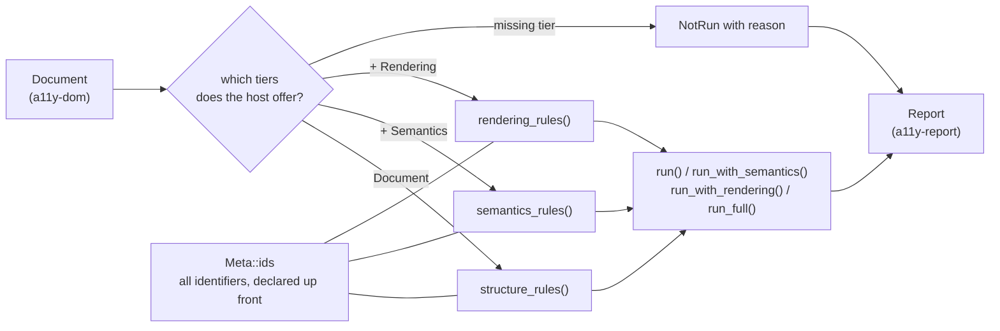

The rule set, generic over `a11y-dom`: one implementation for
build time, CI and the live page. The result is always a `Report` from
`a11y-report`.

## Status

0.26.0 on crates.io. Used by auditmysite (`wcag/shared.rs` calls
`run_with_semantics`), astro-post-audit and liveaudit. The identifiers are stable across
all surfaces and declared in `Meta::ids`: 94 in tier 1 (structure),
35 in tier 2 (semantics), 17 in tier 3 (rendering), 5 over stylesheets. The
complete list is in the [rule reference](../a11y/reference/regeln.mdx).

## Structure

## Public surface

| Entry | Purpose |
|---|---|
| `run`, `run_with_semantics`, `run_with_rendering`, `run_full` | one run, depending on the available tiers |
| `run_stylesheets` | extends a report with the rules over stylesheets (`stylesheet-parse`) |
| `structure_rules`, `semantics_rules`, `rendering_rules` | the rules individually, when a host orchestrates itself |
| `structure_metas`, `semantics_metas`, `rendering_metas`, `stylesheet_metas` | all identifiers up front, without running — for coverage reports |
| `Meta`, `StructureRule`, `SemanticsRule`, `RenderingRule`, `StylesheetRule` | rule types and their declaration |
| `Scope` | which nodes a rule sees: accessibility tree, rendered content or the whole markup |

Two rule groups deliberately do not judge: the **checklist** (`manual/*`,
`UNTESTED` per page and criterion as soon as it is applicable to the page) and
the **heuristics** in tier 3 (`REVIEW`, from `Rendering::layout` and
`bounds`; without this data they report nothing, only the unmeasured
focus visibility remains as `UNTESTED`).

## Normative mapping

A finding with a WCAG criterion and `FAIL` asserts a violation. It may do so
only if the markup proves it. If a rule proves only a recommendation, the
finding carries the keyword `best-practice` and no criterion; if it proves
a suspicion that only a reviewer decides, it is `REVIEW`. The yardstick is WCAG
2.2 with Understanding and Techniques (Fxx are failure techniques, everything else
only sufficient), the W3C's ACT rules and, for comparison, axe-core.

All `FAIL` findings with a criterion were reviewed (as of 0.26.0,
auditmysite#779):

| Rule | Decision | Rationale |
|---|---|---|
| `headings/h1-missing` | Best practice | An h2 is programmatically determinable as a heading (1.3.1); WCAG requires no level. axe `page-has-heading-one` is best practice. |
| `headings/skip-level` | Best practice | 1.3.1 requires determinable levels, not gapless ones; G141 is sufficient, not mandatory. axe `heading-order` is best practice. |
| `headings/none` | 2.4.1 only without any mechanism | Headings (H69), main landmark (ARIA11) and skip link (G1) each suffice on their own. If all three are missing: `FAIL` if navigation or header area are marked up as landmarks, otherwise `REVIEW` — whether blocks repeat across pages is not visible from a single document. |
| `landmarks/main-missing`, `landmarks/main-duplicate` | Best practice | 1.3.1 does not require landmarks, 2.4.1 is also met via headings or a skip link. HTML forbids multiple `<main>`, WCAG does not (4.1.1 was dropped). |
| `landmarks/not-top-level`, `landmarks/banner-duplicate`, `landmarks/contentinfo-duplicate`, `landmarks/content-outside` | Best practice | Like axe `landmark-*-is-top-level`, `landmark-no-duplicate-*`, `region`; no criterion requires landmarks. |
| `zoom/viewport-missing` | Best practice | Without the declaration, zooming remains allowed (1.4.4); 1.4.10 is checked via browser magnification, which the declaration does not affect. |
| `aria/role-redundant`, `lists/role-redundant` | Best practice | The role is correct; 4.1.2 is met. ARIA in HTML merely discourages it. |
| `patterns/tooltip-unreferenced` | Best practice | 1.4.13 governs appearing and disappearing on hover and focus, not the association. |
| `lists/empty` | Best practice | An empty list withholds no information. |
| `tables/header-missing` | `REVIEW` | F91 applies only to data tables with visible headers; whether one is present is not visible from the markup. |
| `keyboard/positive-tabindex` | `REVIEW` | F44 requires a judgment whether the resulting order breaks meaning and operation. axe `tabindex` is best practice. |
| `ids/duplicate` | `REVIEW` | The browser resolves to the first element; whether that is intended is not visible from the markup. |
| `keyboard/click-handler-not-focusable` | `REVIEW` if it contains an element reachable by Tab | The handler then usually only intercepts that element's click (card around its link). Without such an element it remains a violation of 2.1.1. |
| `links/used-as-button` | `REVIEW` | Whether the handler navigates after all is not visible from the markup. |
| `images/server-side-map` | `REVIEW`, 2.1.1 instead of 1.1.1 | The problem is keyboard operation (axe: 2.1.1); equivalent text links next to it satisfy it. |
| `frames/name-missing` | 4.1.2, without 2.4.1 | ACT cae760 lists only 4.1.2; for 2.4.1 the title is one technique among several (H64). |
| `svg/name-missing` | `FAIL` only with an image role, otherwise `REVIEW` | ACT 7d6734 applies only to SVG with an explicit role `img` or `graphics-*`; an SVG without a role may be decoration. |
| `forms/label-missing`, `forms/placeholder-as-label` | Placeholder alone: not `label-missing`, but `REVIEW` | The placeholder provides the name (HTML-AAM, ACT e086e5 passes) and is visible as long as the field is empty. |
| `forms/error-unidentified` | `REVIEW` | A visible error message next to the field satisfies 3.3.1 even without an association (G83). |
| `forms/group-missing`, `forms/group-name-missing` | `REVIEW` | `fieldset` is sufficient (H71), not mandatory; a `fieldset` may also merely style. |
| `forms/no-submit` | `REVIEW` | 3.2.2 is violated only by a change of context on input, not by the missing button (H32 is sufficient). |
| `dialog/focusable-missing` | `REVIEW` | The dialog itself can take focus (`tabindex="-1"`), Escape can close it. |

Unchanged `FAIL` with criterion, because an ACT rule or failure technique supports
the finding: `images/alt-missing`, `images/area-alt-missing`,
`images/input-alt-missing`, `objects/alt-missing` (1.1.1);
`links/name-missing`, `buttons/name-missing`, `summary/name-missing`,
`dialog/name-missing`, `names/required-missing` (4.1.2, ARIA "Name
Required"); `document/lang-missing`, `document/lang-invalid`,
`document/lang-mismatch` (3.1.1, ACT b5c3f8, bf051a, 5b7ae0);
`document/title-*` (2.4.2, ACT 2779a5); `zoom/viewport-locked` (1.4.4, ACT
b4f0c3); `timing/meta-refresh` (2.2.1, ACT bc659a); `headings/empty` (ACT
ffd0e9); `aria/*` and `popover/*` (4.1.2, ACT 5c01ea, 6a7281, 4e8ab6; context
and owned elements 1.3.1, ACT ff89c9, bc4a75); `keyboard/hidden-focusable` (ACT
6cfa84); `keyboard/scrollable-region-not-focusable` (2.1.1, ACT 0ssw9k);
`inert/dialog-inert` (open `<dialog>`); `context/on-input` (F37 with evidence
in the handler; `REVIEW` with a description on the field, G13); `lists/invalid-structure`, `lists/item-outside-list`,
`lists/term-without-definition`, `tables/header-without-data`,
`tables/headers-attr-invalid`, `tables/presentational-with-headers` (1.3.1,
F46, ACT d0f69e, a25f45); `forms/label-missing` without any name (ACT e086e5);
`forms/autocomplete-invalid` (1.3.5, ACT 73f2c2); `label-in-name/mismatch`
(2.5.3, ACT 2ee8b8); `contrast/*` (measured); `color/link-indistinct` (F73,
measured; `REVIEW` if the link color reaches 3:1 against the text, G183); `focus/outline-removed` (F78, site-wide without replacement);
`status/live-overridden` with `aria-live="off"` (4.1.3).

The `viz/*` and `display/*` rules of the display convention carry
`best-practice` and at the same time the nearest criterion (see below); they report
only on pages that use the convention. This duplication is intentional there
and unchanged here.

## ARIA per WAI-ARIA 1.2

The `aria/*` rules check attribute names, value ranges, allowed and
prohibited attributes per role, as well as context and owned elements. The tables for this
are generated from the specification (one bitmask per role). Context and
owned elements run over the DOM, not over the accessibility tree: an `<li>`
in a list with a foreign role counts as `listitem`, even where Chrome
flattens it (auditmysite#715). Native tables and lists without `role` are checked by the
`tables/*` and `lists/*` rules.

## Names

Besides `links/`, `buttons/`, `svg/` and `tables/name-missing`, the rules `dialog/name-missing`, `summary/name-missing` and `names/required-missing`
check the roles for which WAI-ARIA 1.2 requires a name. `label-in-name/mismatch`
compares the name with the visible text per WCAG 2.5.3, and
`status/live-overridden` compares the `aria-live` value of live regions with the
default of their role.

## Forms

`forms/*` checks labeling, groups, error description (`aria-invalid`),
autofill declarations per the HTML standard, submit elements and repeated
entries; `context/*` checks the change of context on focus and input (3.2.1,
3.2.2), `auth/captcha` a captcha in the login form (3.3.8). Whatever can only be guessed from
wording or handlers — purpose of a field, format requirement,
required marking, repetition, captcha — is `REVIEW`. The paste test
on password fields and reading handlers via `window` remain in the host.

## Display convention

`viz/*` and `display/*` check the static half of the
[display convention](../a11y/concepts/darstellungsmodi.md) (draft v0,
casoon/barrierlab#22): `figure[data-viz]` with text, still-image and
live layers, `html[data-display]` with a switch. The rules live here
and not in `web-checks` because they need the DOM; they are tier 1. They report
only on pages that use the convention, carry the keyword
`best-practice` and attach to the nearest WCAG criterion. What only the live
page shows — computed visibility, the timing of `data-display`, the
text mode — is measured by auditmysite.

## Stylesheets

Five rules read the page's stylesheets: `focus/outline-removed` (2.4.7),
`motion/reduced-motion-ignored` (2.3.3), `orientation/content-hidden` (1.3.4),
`text/justified` and `text/line-height-tight` (1.4.8). The host passes the
CSS text of each sheet to `stylesheet_parse::parse_stylesheet` and the report of a
`run_*` to `run_stylesheets`; without this step the five appear in the report
with `NotRun::CapabilityMissing`. Where the text comes from is up to the
host: from `document.styleSheets` in the browser or from the files of a build.

Whether a rule applies on this page is decided by the selector match of
`style-cascade` (subset of Selectors Level 4; states and
pseudo-elements count as satisfied, unknown things such as `:has()` as a possible
match). No cascade with specificity: for body text, the last
matching declaration on the paragraph counts, otherwise on the nearest ancestor.

## Dependencies

Downward: `a11y-dom`, `a11y-report`, `accname`, `stylesheet-parse`. Upward: all hosts,
in future `a11y-wasm`.

## Scope

Each rule declares in `Meta::scope` which nodes it sees, and runs over
a view of the document in which the others are missing:

| `Scope` | missing from the view | Rules |
|---|---|---|
| `AccessibilityTree` | `aria-hidden="true"`, non-rendered content | the normal case |
| `Rendered` | non-rendered content | `keyboard/positive-tabindex`, `keyboard/hidden-focusable`, `keyboard/click-handler-not-focusable`, contrast, the checklist `manual/*` |
| `Markup` | nothing | document-wide rules, `aria/reference-missing`, `ids/duplicate`, `popover/*`, `patterns/tooltip-unreferenced`, `media/audio-autoplay`, `viz/*` and `display/*` (`viz/*` skips figures under `hidden`) |

"Not rendered" means, with tier 3, `display: none` or `visibility: hidden`,
excluding the `hidden` attribute. Without styles, anything hidden via CSS stays in the view
— the honest limit of the static case. `visibility` can become `visible` again on a
descendant; such a descendant is dropped as well.

## Rule corpus and mutations

Each identifier from `Meta::ids` has direct cases in `tests/korpus/`: a
hit with exactly the expected result (a `FAIL` does not satisfy a
`REVIEW` case), a similar-looking conforming counterexample and a
document to which the rule is not applicable; for the last two, the
identifier must demonstrably have run. In addition, edge cases on both sides of each
threshold and the variants relevant to the rule (hidden, native/ARIA,
other labeling routes, shadow DOM). Each case names the norm from which
its expectation derives. The corpus host serves all tiers from the case's
HTML: styles from the `style` attribute, geometry via custom properties,
stylesheets from `<style>`.

`tests/mutations/*.toml` lists at least one targeted mutation per identifier
(invert a condition, shift a threshold, suppress a finding) that a case
must kill. `xtask/mutate.py crates/a11y-rules` applies them one after another in the
working tree, builds, runs the identifier's cases and restores
the file. Two gates in `cargo test` fail as soon as an identifier lacks a case
kind or a killing mutation.

Not representable in the corpus: viewport widths (`@media` is not evaluated by
`text/justified` and `text/line-height-tight`; the interface
knows no width) and dynamic states; the host measures both.

## Limits

What a host does not supply is not guessed: if a tier is missing, `NotRun`
with a reason results. The rules are wording-independent — they check structure and
semantics, not text quality. And they do not replace manual review; which
criteria can be decided by machine at all is documented in `docs/a11y/`.
