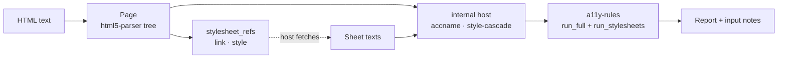

Turns "HTML text and the stylesheet texts the host fetched" into an `a11y-report` `Report`,
so a host only fetches and prints. It replaces the glue that tools otherwise write by hand:
parse tree to `Semantics` via `accname`, `Rendering` over `style-cascade`, stylesheet
discovery, and the right order of `run_full` and `run_stylesheets`.

## Status

0.1.0, not yet published. `barrierlab-cli` will adopt it once it is on crates.io; it does
not yet. The crate is the third place the same chain exists, and astro-post-audit
(casoon/astro-post-audit#115) is the second consumer of the cascade.

## Structure

## Public surface

| Item | Purpose |
|---|---|
| `audit(html, sheets, env)` | one call: parse and audit, English texts |
| `Page::parse(html)` | the parsed document |
| `Page::stylesheet_refs()` | `StylesheetRef::Link { href, media }` and `Inline { css, media }`, in document order |
| `Page::audit(sheets, env, locale)` | runs all rule tiers and the stylesheet rules, adds input notes |
| `Sheet::new(source, css)` | a fetched sheet; `source` is the `href` of the link, verbatim |
| `Sheet::failed(source, reason)` | a sheet the host could not fetch; `reason` becomes the note detail |
| `Sheet::with_media(m)`, `Sheet::with_imports(v)` | the `media` of the link it answers; the sheets it `@import`s |
| `Sheet { source, css, media, failure, imports }` | the fields behind these; `#[non_exhaustive]`, build through the constructors |
| `Environment`, `Locale` | re-exported from `style-cascade` and `a11y-rules` |
| feature `de` | German finding texts |

## Behaviour

- **Discovery.** `<link>` counts with the `rel` token `stylesheet`, without `alternate`, without
  `disabled`, with a non-empty `href`. Every `<style>` counts. Elements inside `<template>` do not.
- **Media.** A `media` attribute wraps the sheet's rules in `@media`; the cascade decides against
  the `Environment`.
- **Matching.** A `<link>` is answered by the `Sheet` with the same `href` and `media` (media
  compared trimmed, ASCII case-insensitive). A `Sheet` without `media` answers any link with that
  `href`; an exact match wins over it. Two links with the same `href` and different `media` each
  need their own `Sheet`.
- **URLs.** `source` is the URL as written; resolving it against the page URL, fetching, and policy
  (size, scheme, redirects) are the host's job. The crate does no I/O and no URL resolution.
- **Imports.** The crate does not follow `@import`. A host that loads imported sheets puts them in
  `Sheet::imports` (matched by `source` equal to the URL in the `@import`, nested to any depth,
  cycles stop at 16 levels or on repetition); the import is then replaced by the imported rules, in
  place, wrapped in `@media` if the import has a media condition. For an `@import` in an inline
  `<style>` the top-level `sheets` are searched. `@import ... layer()` and `supports()` are never
  applied (style-cascade#121) and stay unresolved.
- **Missing input.** A `<link>` without a usable `Sheet` gives `InputKind::StylesheetUnavailable`,
  with `Sheet::failure` as detail if the host gave a reason; so does a qualifying `<link>` with
  empty or missing `href` (no subject; it is not in `stylesheet_refs`, there is nothing to fetch).
  An `@import` that stays unresolved gives `InputKind::StylesheetUnresolved` (detail: the import's
  failure reason, if any). While either note is present, the internal host
  claims no colour or background (`display` and `visibility` stay), so the contrast rules report
  `untested`, never pass or fail on an unstyled page.
- **Not rendered.** `aria-hidden="true"` and `inert` (node or ancestor) make a node ignored;
  `display: none` (including the `hidden` attribute through the UA rules), `visibility: hidden`
  and `collapse` make it not rendered.

## Source positions

`Page::audit` fills `Location::position` (`SourcePosition`: line and column from 1, byte offset
from 0) on every finding whose `Location::node` names a node, after the rules ran; no rule is
involved. The values come from `html5-parser`: the offset is a byte offset into the text handed to
`parse`, and for an element it is the `<` of its start tag. The column counts characters (not
bytes) since the last line break; CRLF and lone CR count as one line break, and the offset still
refers to the original text. Tests over a document with multi-byte text and with CRLF check that
the offset points at the offending tag for `images/alt-missing`, `links/name-missing` and
`buttons/name-missing`.

Findings that get **no** position:

- Findings on a node the parser synthesized (implied `<html>`, `<head>`, `<body>`, `<tbody>`) take
  the position of the nearest ancestor that exists in the source (an implied `<tbody>` points at
  its `<table>`); with no such ancestor (an implied `<html>`) they stay empty.
- Findings without a node (none seen from the current rules; the stylesheet and page rules name
  the root element).

Page-level findings (document language, title, stylesheet rules) name the root element, so
their position is that of an explicit `<html>` tag and empty when the source has none. A finding
on a text node points at the start of the text, not at a tag. A position already present is not
overwritten.

## Dependencies

Downward: `html5-parser`, `a11y-dom` (feature `html5-parser`), `a11y-report`, `a11y-rules`,
`accname`, `style-cascade`, `stylesheet-parse`. Upward: hosts.

## Limits

- No layout: no box geometry, so rules that need it do not decide.
- A sheet supplied for no `<link>` (and no import) is ignored; the host fetches what
  `stylesheet_refs` names.
- Imports are not followed, only the ones the host hands over are applied.
- An unresolved `@import` in a sheet that has a `media` condition is treated as unconditional.
