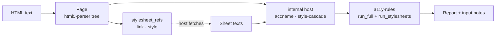

Turns "HTML text and the stylesheet texts the host fetched" into an `a11y-report` `Report`,
so a host only fetches and prints. It replaces the glue that tools otherwise write by hand:
parse tree to `Semantics` via `accname`, `Rendering` over `style-cascade`, stylesheet
discovery, and the right order of `run_full` and `run_stylesheets`.

## Status

0.1.0, not yet published. `barrierlab-cli` will adopt it once it is on crates.io; it does
not yet. The crate is the third place the same chain exists, and astro-post-audit
(casoon/astro-post-audit#115) is the second consumer of the cascade.

## Structure

## Public surface

| Item | Purpose |
|---|---|
| `audit(html, sheets, env)` | one call: parse and audit, English texts |
| `Page::parse(html)` | the parsed document |
| `Page::stylesheet_refs()` | `StylesheetRef::Link { href, media }` and `Inline { css, media }`, in document order |
| `Page::audit(sheets, env, locale)` | runs all rule tiers and the stylesheet rules, adds input notes |
| `Sheet { source, css, media }` | what the host hands back; `source` is the `href` of the link |
| `Environment`, `Locale` | re-exported from `style-cascade` and `a11y-rules` |
| feature `de` | German finding texts |

## Behaviour

- **Discovery.** `<link>` counts with the `rel` token `stylesheet`, without `alternate`, without
  `disabled`, with a non-empty `href`. Every `<style>` counts. Elements inside `<template>` do not.
- **Media.** A `media` attribute wraps the sheet's rules in `@media`; the cascade decides against
  the `Environment`. A `media` on the `Sheet` takes precedence over the one on the link.
- **Missing input.** A `<link>` without a `Sheet` (matched by `href`) gives
  `InputKind::StylesheetUnavailable`; each `Cascade::unresolved_imports()` entry gives
  `InputKind::StylesheetUnresolved`. While either note is present, the internal host
  claims no colour or background (`display` and `visibility` stay), so the contrast rules report
  `untested`, never pass or fail on an unstyled page.
- **Not rendered.** `aria-hidden="true"` and `inert` (node or ancestor) make a node ignored;
  `display: none` (including the `hidden` attribute through the UA rules), `visibility: hidden`
  and `collapse` make it not rendered.

## Dependencies

Downward: `html5-parser`, `a11y-dom` (feature `html5-parser`), `a11y-report`, `a11y-rules`,
`accname`, `style-cascade`, `stylesheet-parse`. Upward: hosts.

## Limits

- No layout: no box geometry, so rules that need it do not decide.
- A sheet supplied for no `<link>` is ignored; the host fetches what `stylesheet_refs` names.
- Imports are not followed; the host may inline them into the `Sheet` text.
- `@import` in a sheet that has a `media` condition is treated as unconditional.
