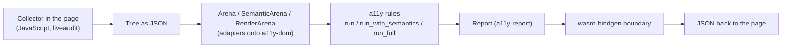

The rule set as WebAssembly: the same rules that run at build time and in CI
run with it **in the opened page**. The package translates, it does not
evaluate.

## Status

Crate 0.14.0 on crates.io, extracted from `liveaudit/packages/core`
(`liveaudit-core`, was `publish = false`). The WASM artifact is published as
the npm package `@casoon/a11y-wasm`; the npm release runs under its own tag
(`a11y-wasm-npm-vX.Y.Z`, see [Releases](https://github.com/casoon/barrierlab/blob/main/docs/releasing.md)) and may lag behind the crate.
The first consumer is liveaudit.

## Structure

Which rules run depends on which columns the collector supplies: structure
only, additionally semantics, additionally rendering. If a layer is missing,
the rule falls back to `NotRun` — not to "passed".

## Building

`wasm-pack` has no `--profile` and would build with `[profile.release]`
(opt-level 3). Here size takes priority over speed, so
`packages/a11y-wasm/build.mjs` builds with `[profile.wasm-release]` and calls
`wasm-bindgen` itself, followed by `wasm-opt -Oz`.

The CLI version of `wasm-bindgen` must match the crate version, otherwise the
step aborts with a schema error.

## Public surface

`Arena`, `SemanticArena`, `RenderArena`, `RenderingColumns` and the
`wasm-bindgen` entry points for a scan. Rust consumers can also use the crate
without WASM as an `rlib`.

`new Scan(...)` takes the eleven column arrays of the collector and validates
them (equal lengths, `attr_start` of node count + 1 entries, monotonic and within
the attribute columns, parents before children, dictionary indices and blob
ranges in bounds). A mismatch makes the constructor **throw an `Error`** naming the
column; it does not trap the module. `run()` is typed: the generated `.d.ts`
carries `Report`, `Finding`, `RuleRun`, `Summary` and the enums, hand-written to
mirror the serialisation of `a11y-report` and checked against it by a test.

## Limits

No collection: the package opens no page and reads no DOM. Anyone who collects the tree
incorrectly gets incorrect findings — responsibility for shadow DOM,
iframes and the timing of the snapshot lies with the collector.
