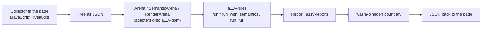

The rule set as WebAssembly: the same rules that run at build time and in CI
run with it **in the opened page**. The package translates, it does not
evaluate.

## Status

Crate 0.14.0 on crates.io, extracted from `liveaudit/packages/core`
(`liveaudit-core`, was `publish = false`). The WASM artifact is published as
the npm package `@casoon/a11y-wasm`; the npm release runs under its own tag
(`a11y-wasm-npm-vX.Y.Z`, see [Releases](https://github.com/casoon/barrierlab/blob/main/docs/releasing.md)) and may lag behind the crate.
The first consumer is liveaudit.

## Structure

Which rules run depends on which columns the collector supplies: structure
only, additionally semantics, additionally rendering. If a layer is missing,
the rule falls back to `NotRun` — not to "passed".

## Building

`wasm-pack` has no `--profile` and would build with `[profile.release]`
(opt-level 3). Here size takes priority over speed, so
`packages/a11y-wasm/build.mjs` builds with `[profile.wasm-release]` and calls
`wasm-bindgen` itself, followed by `wasm-opt -Oz`.

The CLI version of `wasm-bindgen` must match the crate version, otherwise the
step aborts with a schema error.

## Public surface

`Arena` (with `set_scopes`), `SemanticArena`, `RenderArena`, `RenderingColumns`,
`LayoutColumns`, `ProbeColumns` and the `wasm-bindgen` entry points for a scan. Rust consumers can also use the crate
without WASM as an `rlib`.

`new Scan(...)` takes the eleven column arrays of the collector and validates
them (equal lengths, `attr_start` of node count + 1 entries, monotonic and within
the attribute columns, parents before children, dictionary indices and blob
ranges in bounds). A mismatch makes the constructor **throw an `Error`** naming the
column; it does not trap the module. `run()` is typed: the generated `.d.ts`
carries `Report`, `Finding`, `RuleRun`, `Summary` and the enums, hand-written to
mirror the serialisation of `a11y-report` and checked against it by a test.

Optional layers on top of the arena, each its own call before `run()`:
`withRendering(color, background, font_size_px, font_weight, flags)` for the
computed styles (Tier 3, without it the contrast rules do not run) and
`withLayout(flags, order, min_width_px, bounds)` for the heuristic rules; plus
the two groups below.

## Tree scopes (shadow DOM)

`scan.withScopes(scopes: Uint32Array)` takes one tree scope per node, parallel
to the node columns: `0` is the document, every other number a shadow root
(chosen by the collector, unique per document, below the node count). A node
inserted through a `<slot>` carries the scope of the **outer** tree, not that of
the shadow root it hangs under in the flat tree. `a11y-dom` resolves IDs per scope
(`aria-labelledby`, `aria-describedby`, `label[for]`, `headers`, duplicate IDs): a
reference only hits targets of its own scope, and the same ID in two scopes is no
duplicate. Without the call every node is in the document. A mismatch (length,
`scopes[0] != 0`, a value at or above the node count) makes the call throw an
`Error` naming the column. Call it before `run()`.

## Probe columns (cargo feature `probes`, default)

Five rules read measurements that only the page can supply: the
`Rendering` methods `frame_reachable`, `box_transform`, `paste_probe`,
`focus_cover` and `text_spacing_clip` of `a11y-dom` (their doc comments define
what is measured). Each has its own method on `Scan`. **A column that is not
supplied is "not measured" (`None`) and its rule is recorded as `NotRun` with a
reason; a supplied column counts as measured.** All columns are sparse: `nodes`
lists arena indices in strictly ascending order, every value array is parallel
to it. Nodes a column does not list are not measured. They only take effect
together with `withRendering`, like `withLayout`.

| Method | Rule | Value arrays |
|---|---|---|
| `withFrames(nodes: Uint32Array, reachable: Uint8Array)` | `frames/cross-origin` | `reachable`: `1` readable, `0` not readable |
| `withTransforms(nodes: Uint32Array, transform: string[], rotate: string[])` | `orientation/root-rotated` | computed `transform` and `rotate` of `html`/`body` as serialised by the browser; `""` = field not measured |
| `withPasteProbes(nodes: Uint32Array, flags: Uint8Array)` | `auth/paste-blocked` | `flags`: bit 0 event cancelled, bit 1 probe text inserted |
| `withFocusCover(nodes: Uint32Array, points: Uint32Array, covered: Uint32Array, blocker: Int32Array)` | `focus/obscured`, `focus/obscured-enhanced` | sample points, covered points (at most `points`), node index of the topmost blocker or `-1` |
| `withTextSpacing(nodes: Uint32Array, flags: Uint8Array)` | `text-spacing/clipped` | `flags`: bit 0 clipped before, bit 1 clipped after the text-spacing override |

Calling a method again replaces its column. Validation throws an `Error`
(`invalid <column> columns: …`) for unequal lengths, node indices that are not
strictly ascending or outside the arena, flag bits outside the table,
`covered > points` and a `blocker` outside the arena; it does not trap the module.
The TypeScript signatures come from the generated `.d.ts`.

The feature is on by default; `--no-default-features` builds the lean variant
without the methods. The columns pull the bodies of the five rules into the
artifact, about 9 KB gzip. Budget decision of 2026-11-09 (liveaudit#16): the gzip
budget rises from 170 KB to 180 KB (earlier steps: 110, 130, 150, 170 KB) and the
columns ship in the default build (measured 183,122 bytes gzip, 178.8 KiB).

## Limits

No collection: the package opens no page and reads no DOM. Anyone who collects the tree
incorrectly gets incorrect findings — responsibility for shadow DOM,
iframes and the timing of the snapshot lies with the collector.
