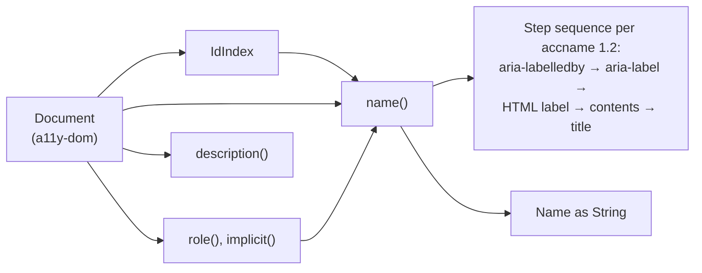

Accessible Name and Description Computation per WAI-ARIA (accname 1.2) and
HTML-AAM, generic over `a11y-dom`. The entry point for everything that needs a
name.

## Status

0.26.0 on crates.io. Checked differentially against Chrome: auditmysite has
`accname-diff` for this; on the first corpus 381 of 395 names matched, and
the deviations all came from `contents` — the dominant cause is CSS
`text-transform`, which Chrome applies to the name and `accname` does not.

## Structure

## Public surface

| Entry | Purpose |
|---|---|
| `name`, `description` | the two computations |
| `role`, `implicit`, `allows_name_from_content`, `name_is_prohibited` | role knowledge the step sequence needs |
| `IdIndex` | resolution of `aria-labelledby`/`aria-describedby` without repeated tree searches |

## Dependencies

Downward: `a11y-dom`. Upward: `a11y-rules`, hosts with document-based
collection.

## Limits

`name()` sees no CSS: `text-transform`, `::before`/`::after` and the
browser's visibility rules are not modeled. A space therefore always separates the parts
of a name, even for inline elements:
`<abbr>EU</abbr>-Arktis` yields "EU -Arktis", Chrome "EU-Arktis". Only
what carries `hidden` or `aria-hidden="true"` counts as hidden. A decision based on the
tag was tried in 0.11.1 and reverted in 0.11.2 — on real pages
`` is often a block element via CSS (auditmysite corpus: 450 new
deviations against 5 fixed).

Hosts with computed styles ([`Rendering`](a11y-dom.md), tier 3) call
`name_rendered(doc, node, ids)`. There, children with `display: inline`
or `contents` attach directly, all others and replaced elements (`img`, `svg`, …)
are set apart, ` ` always separates; `display: none` (also on an
ancestor) and `visibility: hidden` hide content — a `<label>` hidden this way
also no longer names its field — except for an explicit
reference via `aria-labelledby`. The host must supply the whitespace text nodes
— CDP `DOM.getDocument` omits them, `DOMSnapshot` does not. In the
auditmysite corpus (35 pages) this leaves one real deviation pattern instead of
six. `text-transform` and `::before`/`::after` remain out of scope there as well.

`<dt>` (role `term`) gets no name from content: `term` is listed neither in
ARIA 1.2 nor in the ARIA 1.3 draft under "name from content", and in the draft
explicitly under "name prohibited". Chrome nevertheless names `<dt>` from its
content — an expected deviation. Where a host has native values (Chrome via CDP),
these are to be marked separately — not silently swapped for this package's own
computation.
