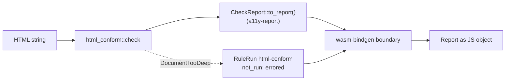

`html-conform` as WebAssembly: `check(html)` returns the findings in the shared model. The package
translates, it does not check.

## Status

Crate `html-conform-wasm` 0.1.0 and npm package `@casoon/html-conform-wasm`, not yet published.
The npm release runs under its own tag (`html-conform-wasm-npm-vX.Y.Z`, see
[Releases](https://github.com/casoon/barrierlab/blob/main/docs/releasing.md)). Use cases are editor
integrations, browser extensions, Cloudflare Workers and LiveAudit.

## Structure

## Building

`packages/html-conform-wasm/build.mjs` builds like the one of `a11y-wasm`: `[profile.wasm-release]`,
the `wasm-bindgen` CLI in the version of `Cargo.lock`, then `wasm-opt -Oz`. At the end it checks
the size budget and aborts when it is exceeded. The HTML5 schema is not compiled at load time: the
artefact `crates/html-conform/prebuilt/html5.rngc` (barrierlab#72) is embedded and read at the
first call.

## Size and start-up

Measured on 2026-11-09 (barrierlab#73), Node 24, Apple silicon, `wasm-opt` 133:

| | Value |
|---|---|
| WASM, raw | 1,988 KiB (2,035,930 bytes) |
| WASM, gzip -9 | 747.2 KiB (765,111 bytes) |
| WASM, brotli | about 563 KiB |
| npm tarball | 793.6 kB |
| Budget (`build.mjs`) | 760 KiB gzip |
| `initSync` (instantiate) | 2 to 5 ms |
| first `check` (small document) | 65 to 91 ms |
| later `check` calls (same document) | 7 to 15 ms |

Most of the size is data: the prebuilt schema is 217 KiB raw, the rest is the parser, the
RELAX NG validator, the XPath engine and the Schematron rules. The first call pays for loading
the schema and the rule set, later calls reuse them.

## Public surface

`check(html: string): Report` and the TypeScript types of the report, hand-written to mirror the
serialisation of `a11y-report` (a test compares the fields). `Finding.location.position` carries
line, column (both from 1) and the byte offset. Severity mapping as in `CheckReport::to_report()`:
an error is `fail` with `medium` weight, a warning `review`, an info `untested`.

## Not run is visible

- Content the checker does not validate (CSS in `<style>`, CSP hash sources) appears in
  `inputs` as `document_incomplete`.
- A document nested deeper than 512 levels yields no findings and a `rule_runs` entry
  `html-conform` with `not_run: "errored"` and a reason.
- `check` throws an `Error` if the checker cannot be set up.

## Dependencies

Downward: `html-conform` and `a11y-report`. Upward: nobody inside this repository.

## Limits

The check is compared differentially against vnu, not identical to it; which classes are missing
is listed in the [html-conform documentation](../html-conform/index.md). The package does not fetch
a page and does not parse anything but the string it is given. It is single-threaded: a long
document blocks the thread it runs on, so run it in a worker for large input.
