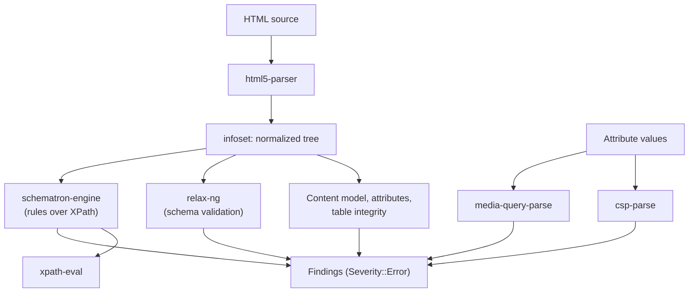

HTML5 conformance checking as a Rust dependency, without a JVM. Checked
differentially against the Nu Html Checker (vnu). It includes six standalone packages that
read the syntax the check needs.

## Status

0.2.1 on crates.io, used by auditmysite (`src/html_conform/`) and
astro-post-audit (`checks/html_validation.rs`). `main` contains changes
after 0.2.1: MSRV raised to 1.88, additional findings (`img` without `alt`, interactive
content in `a`).

**With the move, the `=` pins are gone.** Previously html-conform depended on exact
versions of four of its six dependencies, because every change needed a
release cascade across seven repositories. Now they are workspace
dependencies with `path` and `version` — one change, one release.

## Structure

| Package | Role |
|---|---|
| `html5-parser` | WHATWG tokenizer and tree construction, reports parse errors with position |
| `csp-parse` | Content Security Policy per the CSP3 grammar |
| `media-query-parse` | Media Queries Level 4 |
| `xpath-eval` | XPath evaluation |
| `relax-ng` | RELAX NG, for the schema side of the check |
| `schematron-engine` | Schematron rules over `xpath-eval` |

## Public surface

`html_conform::check(html)` returns the findings. The six packages underneath each
have their own small API and can be used individually — `xpath-eval`
and `schematron-engine`, for example, also outside of HTML.

## Dependencies

Downward: the six above. Upward: auditmysite, astro-post-audit, in future
`web-checks`.

## Limits

Not a complete vnu replacement. The check is calibrated differentially against vnu,
not identical to it; which classes are missing is documented in
`docs/html-conform/`. And it says nothing about accessibility — conformance is
a different question from perceivability.

Checking goes up to a nesting depth of 512 elements. Deeper
documents yield `CheckError::DocumentTooDeep` instead of a report — the
check layers after the parser recurse over the tree and would otherwise blow the
stack of a 2 MiB thread. The parser itself knows no limit, because
WHATWG tree construction has none; Blink stops nesting at 512 and attaches deeper elements as siblings. html-conform deliberately does not adopt this
flattening: findings would then apply to a tree that
the specification does not build. The limit uses the latitude that the
HTML standard leaves for implementation-specific limits on otherwise unbounded
input, by rejecting the check rather than checking something different.
