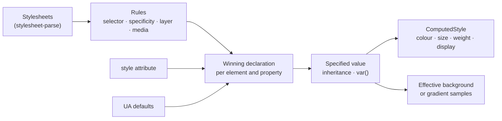

Computes, for a document and the stylesheets of its page, which declaration wins on
which element: origin, `!important`, cascade layers, the `style` attribute, specificity and
source order, then inheritance and `var()`. From that it derives the `ComputedStyle` of
`a11y-dom` for the rendering tier, including the effective background colour behind text.
It does no layout and runs no scripts.

## Status

0.1.0, not yet published. Used by `a11y-rules` for the selector match of its stylesheet rules,
and by `barrierlab-cli` as the rendering tier of a browser-free audit. astro-post-audit is the
planned second host for the cascade (casoon/astro-post-audit#115).

Compared with Chrome's `getComputedStyle` on five real pages (casoon.dev, the auditmysite and
barrierlab sites, Hacker News, a Wikipedia article; 1280 px light, dark and 390 px wide where the
styles differ): text colour (about 2,800 elements), effective background (about 1,600 where
determined), font size and weight agree on all but two elements (Chrome's 13 px default for
`monospace`, see Limits). Hacker News showed that presentational attributes (`bgcolor`,
`<font color>`) must count; they do now. Not compared: the luminance samples over gradients, and
pages with heavy use of container queries or `:has()`, which come out undetermined.

## Structure



## Public surface

| Item | Purpose |
|---|---|
| `Cascade::new(sheets, Environment)` | builds the cascade for one document (reads and indexes the sheets) |
| `RuleSet::new(&[&Stylesheet], Environment)` | the compiled, indexed rules: immutable, `Send + Sync`, owned by no document |
| `Cascade::with_rules(Arc<RuleSet>)` | a cascade over a shared `RuleSet`; only the per-document caches are created |
| `Cascade::specified` | the specified value of a property: `Set`, `Unset` or `Unknown` |
| `Cascade::computed_style` | the `ComputedStyle` for `Rendering::computed_style` |
| `Cascade::effective_background` | the colour behind the text, `None` if it cannot be known |
| `Cascade::backdrop_luminances` | luminance samples where a gradient lies behind the text |
| `Import::parse`, `Import::wrap` | reads an `@import` prelude; turns the sheet the host supplies into the rules that replace the import (layer, `@supports`, `@media`) |
| `expand_imports(css, resolver)` | replaces every `@import` the resolver answers (`Resolution::Css`) by the wrapped rules, recursively; `Inert` drops it, `Failed` and `Unresolved` leave it; cycles and more than 16 levels stop |
| `imports_in(css)`, `wrap_media(rules, media)` | the top-level `@import`s of a text, parsed; the `@media` wrapper for a `<link media>` that keeps `@import` at the top |
| `Cascade::is_dark(node)` | the used colour scheme at an element (`Some(true)` dark) |
| `selector::Selector`, `Specificity`, `Mode` | selector matching; `Resting` for the cascade, `Possible` for "could this rule apply?" |
| `parse_color`, `over`, `luminance` | CSS colours (including `oklch()`, `lab()`, `color-mix()` in srgb and oklab) and compositing |
| `Environment` | the assumed window: size, colour scheme, reduced motion; optional hover, pointer, contrast and forced-colors (`Unknown` when unset) |

## Sharing the rules across pages

`Cascade` belongs to one document (its caches are keyed by node ID and are not `Sync`). What
does not depend on the document, the parsed rules and their index by id, class and type, is the
`RuleSet`. A host whose pages share stylesheets builds it once, wraps it in an `Arc` and makes one
`Cascade::with_rules` per page: no clone of the sheets and no re-indexing per page. A `RuleSet` is
evaluated against one `Environment`; another environment needs another set. `Cascade::new` is the
same two steps in one call, so existing code keeps working.

```rust
let rules = Arc::new(RuleSet::new(&[&base, &theme], Environment::default()));
for page in pages {
    let cascade = Cascade::with_rules(Arc::clone(&rules)); // cheap, per page
}
```

## Imports

The cascade fetches nothing. A host that loads imported sheets (or knows about them) hands them
to `expand_imports` through a resolver; that code used to live in `a11y-static` and is public
here, so that a host with its own adapter (astro-post-audit) does not rebuild it. It sits in
`style-cascade` rather than `a11y-static` because it only needs `Import` and `stylesheet-parse`,
both already here, and a host that uses just the cascade should not depend on the HTML audit
crate (L2 below L3 stays as it is).

The resolver gets the parsed `Import` and the chain of the URLs it is nested in. It answers:

| `Resolution` | Effect |
|---|---|
| `Css(text)` | the text is read, its own imports go to the same resolver, the rules replace the `@import` wrapped in its layer, `supports()` and media |
| `Inert` | the host declares the sheet has no rules that set a style (see below); the `@import` is dropped |
| `Failed(reason)` | the `@import` stays, the reason is in `ExpandedImports::failures` |
| `Unresolved` | the `@import` stays |

**Web-font imports.** `@import url(https://fonts.googleapis.com/css?family=X)` points at a sheet
that, in practice, only holds `@font-face`. The cascade cannot know that (it never reads URLs and
never guesses from one), and an unresolved import makes every property unknown, so the contrast of
the whole page is undetermined. The way out is the host's declaration: it answers `Inert` for the
imports it knows to be font sheets. The host owns the decision; if the sheet does set colours after
all, the findings are wrong instead of undetermined.

## Colour scheme

Checked against CSS Color Adjustment Module Level 1 (§2, `color-scheme`). Before, the cascade did
not honour `color-scheme`: the UA colours were fixed light values (`#0000ee` for links, black text,
white canvas) and `light-dark()` followed the `prefers-color-scheme` of the `Environment` directly.
A blue default link on a near-black page therefore came out as a contrast failure in a dark run
although the browser paints it light blue. That was a false alarm. Now:

- `color-scheme` is inherited (§2.1); the initial value `normal` is light. There is no automatic
  darkening: a page without `color-scheme` is light in a dark environment too.
- The used scheme (§2.2) of an element: if `Environment::dark` matches a scheme in the list, that
  one, otherwise the first of the list (`light` → light, `dark` → dark, `light dark` → the
  environment's preference, `only` is ignored). `Cascade::is_dark` gives it; an undetermined
  `color-scheme` makes colours undetermined.
- `<meta name="color-scheme" content="light dark">` in the head acts as a presentational hint for
  the root element (lowest author rank, any rule overrides it), per the HTML standard metadata
  names.
- The UA defaults are system colours (CSS Color 4 §6.2), resolved against the element's scheme:
  text `CanvasText`, links `LinkText` (`:visited` is not evaluated), form-control text `FieldText` /
  `ButtonText`, control backgrounds `Field` / `ButtonFace`, the page `Canvas` (the scheme of the
  **root element**). `specified("color")` on a link now returns `linktext`, not `#0000ee`. The
  values are Chromium's, since the specification leaves them to the user agent: light Canvas
  `#ffffff`, CanvasText `#000000`, LinkText `#0000ee`, VisitedText `#551a8b`, ActiveText `#ff0000`,
  ButtonFace `#efefef`, Field `#ffffff`; dark Canvas `#121212`, CanvasText `#ffffff`, LinkText
  `#9e9eff`, VisitedText `#d0adf0`, ActiveText `#ff9e9e`, ButtonFace `#6b6b6b`, Field `#3b3b3b`.
  `parse_color` reads these keywords too.
- `light-dark()` and every colour read use the used scheme of the element they apply to, not the
  environment's preference.

Not done: the `<meta>` scheme does not reach `color-scheme` of a shadow tree or `<iframe>`, `forced-colors`
system colours, and `mark`'s fixed yellow stays in dark mode.

## Dependencies

Downward: `a11y-dom`, `stylesheet-parse`, `media-query-parse`. Upward: `a11y-rules`, hosts.

## Limits

What cannot be determined without layout stays undetermined, never guessed:

- **`Unknown` propagates.** A rule whose selector or `@media` condition is not understood
  (`:has()`, `@container`, resolution queries, `hover`/`pointer` queries without a value in `Environment`) makes every property it declares unknown on the
  elements it could match, unless a certain rule with higher weight wins anyway.
- **Backgrounds.** A background image makes the colour unknown. A gradient gives luminance
  samples (each stop and the midpoints), not every pixel. `opacity`, `filter` and blend modes
  anywhere up the chain, and `position: absolute|fixed` or non-blur `backdrop-filter` in front
  of the first opaque surface, make the background unknown.
- **No layout.** Overlap, sizes and what an absolutely positioned box really sits on are not
  known.
- **Approximations.** `@supports` conditions count as true unless negated; layers (named, dotted, nested and anonymous, Cascade 5 §6.4) rank by first
  appearance in document order; a layer first seen only under a condition with unknown outcome
  (`@container`, unknown `@media`) or with an invalid name has no certain rank, so its rules
  make the properties they declare `Unknown`; colours outside sRGB are clipped, not gamut-mapped; the page
  is light unless `color-scheme` (or `<meta name=color-scheme>`) says otherwise; see Colour scheme.
- **`@import`.** An unresolved `@import` makes all answers `Unknown` (except an inline `!important`)
  until the host replaces it with `Import::wrap(rules)` of the imported sheet (or `expand_imports`, see Imports): `layer` and
  `layer(x)` put the rules in that layer (Cascade 5 §6.4.1), `supports()` and a media list apply to
  the whole sheet. The cascade fetches nothing and resolves no URLs. Layer names are compared
  after CSS unescaping; presentational hints rank below all author rules, layered or not. An
  import whose media condition fails does not create its layer (same as a failing `@media`).
- **Monospace size.** Chrome shrinks the default size to 13 px for `font-family: monospace`;
  the cascade does not, so `<code>` can come out 16 px where Chrome has 13 px.
- **Presentational attributes** are read for `bgcolor`, `background`, `<font color>`, `<font size>`,
  `<body text>` and `<body link>`; other legacy attributes are ignored.
- **Shorthands** are expanded only for `background`, `font`, `border*`, `text-decoration` and
  `list-style`; `all` is ignored.
- **One document per cascade.** Caches are keyed by node ID. The `RuleSet` underneath is shareable.
