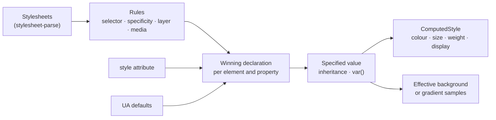

Computes, for a document and the stylesheets of its page, which declaration wins on
which element: origin, `!important`, cascade layers, the `style` attribute, specificity and
source order, then inheritance and `var()`. From that it derives the `ComputedStyle` of
`a11y-dom` for the rendering tier, including the effective background colour behind text.
It does no layout and runs no scripts.

## Status

0.1.0, not yet published. Used by `a11y-rules` for the selector match of its stylesheet rules,
and by `barrierlab-cli` as the rendering tier of a browser-free audit. astro-post-audit is the
planned second host for the cascade (casoon/astro-post-audit#115).

Compared with Chrome's `getComputedStyle` on five real pages (casoon.dev, the auditmysite and
barrierlab sites, Hacker News, a Wikipedia article; 1280 px light, dark and 390 px wide where the
styles differ): text colour (about 2,800 elements), effective background (about 1,600 where
determined), font size and weight agree on all but two elements (Chrome's 13 px default for
`monospace`, see Limits). Hacker News showed that presentational attributes (`bgcolor`,
``) must count; they do now. Not compared: the luminance samples over gradients, and
pages with heavy use of container queries or `:has()`, which come out undetermined.

## Structure

## Public surface

| Item | Purpose |
|---|---|
| `Cascade::new(sheets, Environment)` | builds the cascade for one document |
| `Cascade::specified` | the specified value of a property: `Set`, `Unset` or `Unknown` |
| `Cascade::computed_style` | the `ComputedStyle` for `Rendering::computed_style` |
| `Cascade::effective_background` | the colour behind the text, `None` if it cannot be known |
| `Cascade::backdrop_luminances` | luminance samples where a gradient lies behind the text |
| `Import::parse`, `Import::wrap` | reads an `@import` prelude; turns the sheet the host supplies into the rules that replace the import (layer, `@supports`, `@media`) |
| `selector::Selector`, `Specificity`, `Mode` | selector matching; `Resting` for the cascade, `Possible` for "could this rule apply?" |
| `parse_color`, `over`, `luminance` | CSS colours (including `oklch()`, `lab()`, `color-mix()` in srgb and oklab) and compositing |
| `Environment` | the assumed window: size, colour scheme, reduced motion; optional hover, pointer, contrast and forced-colors (`Unknown` when unset) |

## Dependencies

Downward: `a11y-dom`, `stylesheet-parse`, `media-query-parse`. Upward: `a11y-rules`, hosts.

## Limits

What cannot be determined without layout stays undetermined, never guessed:

- **`Unknown` propagates.** A rule whose selector or `@media` condition is not understood
  (`:has()`, `@container`, resolution queries, `hover`/`pointer` queries without a value in `Environment`) makes every property it declares unknown on the
  elements it could match, unless a certain rule with higher weight wins anyway.
- **Backgrounds.** A background image makes the colour unknown. A gradient gives luminance
  samples (each stop and the midpoints), not every pixel. `opacity`, `filter` and blend modes
  anywhere up the chain, and `position: absolute|fixed` or non-blur `backdrop-filter` in front
  of the first opaque surface, make the background unknown.
- **No layout.** Overlap, sizes and what an absolutely positioned box really sits on are not
  known.
- **Approximations.** `@supports` conditions count as true unless negated; layers (named, dotted, nested and anonymous, Cascade 5 §6.4) rank by first
  appearance in document order; a layer first seen only under a condition with unknown outcome
  (`@container`, unknown `@media`) or with an invalid name has no certain rank, so its rules
  make the properties they declare `Unknown`; colours outside sRGB are clipped, not gamut-mapped; the page
  is assumed in the default light scheme unless `Environment` says otherwise.
- **`@import`.** An unresolved `@import` makes all answers `Unknown` (except an inline `!important`)
  until the host replaces it with `Import::wrap(rules)` of the imported sheet: `layer` and
  `layer(x)` put the rules in that layer (Cascade 5 §6.4.1), `supports()` and a media list apply to
  the whole sheet. The cascade fetches nothing and resolves no URLs. Layer names are compared
  after CSS unescaping; presentational hints rank below all author rules, layered or not. An
  import whose media condition fails does not create its layer (same as a failing `@media`).
- **Monospace size.** Chrome shrinks the default size to 13 px for `font-family: monospace`;
  the cascade does not, so `<code>` can come out 16 px where Chrome has 13 px.
- **Presentational attributes** are read for `bgcolor`, `background`, ``, ``,
  `<body text>` and `<body link>`; other legacy attributes are ignored.
- **Shorthands** are expanded only for `background`, `font`, `border*`, `text-decoration` and
  `list-style`; `all` is ignored.
- **One document per cascade.** Caches are keyed by node ID.
