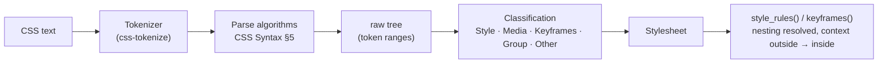

Reads raw CSS text into rules, at-rules and declarations and flattens them —
through `@media`, group rules and nesting — into style rules with
resolved selectors and their context. It evaluates nothing: no
cascade, no selector matching, no evaluation of media queries.

## Status

0.1.0 on crates.io. Used by `a11y-rules` and `style-cascade`; `a11y-rules`
checks stylesheet rules (`outline: none` on `:focus`,
`prefers-reduced-motion`, media queries on orientation,
`text-align`/`line-height`). The hosts pass the text in: auditmysite
from the browser's stylesheets, astro-post-audit from `dist/*.css` and
`<style>`.

Tested on 337 real stylesheets from 48 pages (24 MB) as well as on Bootstrap
5.3.3 and Tailwind 2.2.19 (3.6 MB): no panic, about 0.1 s per MB in the
release build.

## Structure

## Public surface

| Entry | Purpose |
|---|---|
| `parse_stylesheet` | text → `Stylesheet`; never fails |
| `Stylesheet`, `Rule` and the rule types | the tree as it stands in the source |
| `Declaration` | name (lowercase), value (serialized, without `!important`), `important` |
| `Stylesheet::style_rules` | every style rule flattened, as `Scoped` with `Context` |
| `Stylesheet::keyframes` | every `@keyframes` rule with `Context` |

Nesting: `&` at the start of a selector is replaced by the parent selector
(by `:is(a, b)` if there are several), elsewhere by `:is(parent)`, and a
selector without `&` is treated as `& selector`. Declarations directly in a
nested `@media` apply to the parent selector.

## Dependencies

Downward: `css-tokenize`. Upward:
`a11y-rules` (planned).

## Limits

- **Serialized, not original.** Values and selectors are rebuilt from the
  tokens: whitespace collapsed, comments gone, numbers compact (`.5` → `0.5`,
  `1.0` → `1`), strings always with `"`. Re-tokenized they yield
  the same tokens; the details are in the package's README.
- **No selector validation.** Only what no grammar can match is discarded:
  erroneous tokens, empty entries in a selector list. Whether a
  selector is otherwise valid is not decided by the package.
- **Unknown at-rules** end up as `Other`; rules inside their block are missing —
  a browser does not apply them either.
- **Limits against malicious input:** blocks deeper than 128 levels are
  dropped, as are resolved selectors over 64 KiB.
