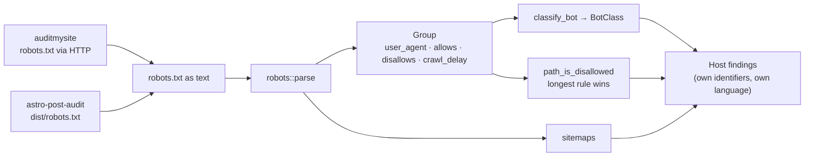

The shared evaluation of two auditors that check the same thing on the same page:
auditmysite via a live page in Chrome, astro-post-audit via a built
`dist/`. The collection differs, the evaluation is the same.

## Status

0.5.0, families `robots`, `meta`, `social`, `structured_data` and `hreflang`. More follow
individually; render-blocking was examined and stays out (shared, it would be about
five lines, the rest are different checks).

## What the package does not do

- **It fetches nothing.** No HTTP, no file system, no browser.
- **It words nothing.** Finding identifiers, severities and texts stay with the
  host; they differ there and are multilingual. What lives here is data and
  predicates.

The second is a decision against the first draft: shared
`Finding` return values would have forced unifying the identifiers of both tools.
That is a separate, visible decision — not the side effect of a move.

## Structure

## What the merge uncovered

The two tools contradicted each other on the same bots — on the same page
they would have reported opposite things:

| Bot | auditmysite | astro-post-audit | now |
|---|---|---|---|
| GPTBot | Training | **Citation** | Training |
| ClaudeBot | Mixed | **Citation** | Mixed |
| anthropic-ai | Mixed | **Citation** | Mixed |

What counts is what the vendors themselves write: OpenAI separates `GPTBot`
(training) from `OAI-SearchBot` (search), Anthropic `ClaudeBot` from
`Claude-SearchBot` and `Claude-User`. The search variants were missing from both
registries and are now included.

That is the yield of this slice: not fewer lines, but **one** answer
instead of two contradictory ones. For astro-post-audit the findings change
accordingly — "AI citation bot blocked" becomes, for GPTBot,
"AI training bot blocked", which is the usual and unremarkable situation.

### `meta` and `social` (0.3.0)

Both tools checked title and description length with the same limits
(60 / 160) — and both in **bytes**: an umlaut counted twice, "Überschrift"
was too long sooner than "Ueberschrift". `meta::length` counts characters after
browser-style whitespace collapsing. The minimum lengths (30 / 120) existed
only in auditmysite; the package carries both limits, the host decides which
it reports.

For OpenGraph, a tag counted as present in auditmysite as soon as the element
existed, in astro-post-audit only with content. Now uniform: empty
content counts as missing. The value checks from astro-post-audit (`twitter:card` only
`summary`, `summary_large_image`, `app`, `player`; `og:image` absolute) are
now available to both.

### `structured_data` (0.4.0)

Both tools evaluate JSON-LD, and their tables contradicted each other on
almost every shared type. The basis is now auditmysite's table, because it is
documented: every assessment references the Google Search Central page on the
feature and carries the table's version. The decisions in detail:

| Point | astro-post-audit | auditmysite | now |
|---|---|---|---|
| Presence | key exists | not empty | not empty (`""`, `null`, `[]`, `{}` count as missing) |
| `@context` | substring `schema.org` | exact, lists, `@vocab`, inheritance in `@graph` | exact like auditmysite; missing and foreign kept separate; under a foreign context only full schema.org IRIs count as a type (JSON-LD 1.1) |
| Root list, `@type` list | not resolved, only first type | resolved, all types | resolved, all types |
| Organization, Person, WebSite | `name` (and `url`) required | recommendations only | recommendations only (as Google documents it) |
| Article | `headline` required | recommendations only | recommendations only |
| NewsArticle `publisher` | required | — | recommended |
| WebSite `potentialAction` | low | — | recommended; the sitelinks search box no longer exists since 2024, the host decides the weight |
| LocalBusiness | `name` required | `name`, `address` required | `name`, `address` required |
| FAQPage | `acceptedAnswer` per question | only `mainEntity` | both, plus `name` per question and `text` per answer (Google FAQ) |
| BreadcrumbList | `name` also via `item.name` | ≥ 2 entries, `item` except for the last, `name` directly | ≥ 2 entries, `item` except for the last, `name` also via `item.name` |
| Duplicate `@type` across blocks | yes | no | `duplicate_types`, the host switches it |
| Event, Recipe, VideoObject, JobPosting, SoftwareApplication, ProfilePage, CollectionPage, ItemList, Merchant Listing | — | yes | yes |

Two things that used to be sentences became data in the move: the hints
for manual review (`ManualReview` instead of English sentences) and the structural problems
(`StructuralIssue` instead of message text). Labels of the features and
status texts stay with the host.

Comparison with visible content (needs the rendered page), consistency across
all pages of a build, Microdata and RDFa stay out.

### `hreflang` (0.5.0)

Both tools check `x-default` and the reference to the page itself, only
auditmysite the language code. Comparison case by case:

| Point | astro-post-audit | auditmysite | now |
|---|---|---|---|
| `x-default` present | exactly `x-default` | exactly `x-default` | regardless of capitalization |
| Reference to itself | every entry, also `x-default`; query discarded | every entry, also `x-default`; query kept | excluding `x-default` (Google: each language version names itself); query kept, fragment and trailing slash do not count |
| Language code | — | `xx`, `xxx`, `xx-YY` with uppercase region | language, optional script and region, any capitalization (Google's subset of BCP 47) |
| Return links between pages | yes | — | stays with the host |
| Target exists in the build | yes | — | stays with the host |

What changes: the German home page of heise.de names itself only as
`x-default` and counted as complete in both; now it lacks the reference
to itself. Versions that differ only in the query
(`?lang=de`) counted as references to each other in astro-post-audit. auditmysite
considered `de-de` and `zh-Hant` invalid. The 23 codes on nine of the 48
real pages examined are valid under both the old and the new check.

## Public surface

| Entry | Purpose |
|---|---|
| `robots::parse` | text → `RobotsTxt` with groups and sitemaps |
| `RobotsTxt::wildcard_disallows_all`, `blocks`, `crawl_delays` | the questions both hosts ask |
| `Group::disallows_path` | does a block apply to this path |
| `classify_bot`, `BotClass` | classification as data, without judgment |
| `path_is_disallowed` | longest-rule evaluation with `*` and `$` |
| `meta::length`, `LengthRange::classify`, `meta::TITLE`, `meta::DESCRIPTION` | length in characters, classification too short / ok / too long |
| `social::is_present`, `is_complete`, `completeness` | presence (empty = missing) and completeness via `*_REQUIRED` / `*_FIELDS` |
| `social::is_valid_twitter_card`, `is_absolute_url` | value checks |
| `structured_data::parse_blocks`, `parse_block` → `Block { nodes, issues, json_error }` | script text → normalized nodes and `StructuralIssue` |
| `structured_data::has_schema_org_context`, `extract_types`, `normalize_schema_type` | the building blocks of normalization |
| `structured_data::assess_node`, `SchemaRuleAssessment`, `ProductRuleContext` | assessment per node and type: missing required and recommended paths, feature, availability, source |
| `structured_data::inventory_fields` | fields per type for an inventory |
| `structured_data::duplicate_types` | `@type` in more than one block |
| `structured_data::RULESET_VERSION` | version of the rule table |
| `hreflang::Alternate` | a `link rel=alternate hreflang` with an `href` resolved by the host |
| `hreflang::is_valid_code`, `invalid_codes`, `is_x_default`, `has_x_default` | language code and `x-default` |
| `hreflang::has_self_reference`, `same_page` | reference to the page itself, URL comparison |

## Limits

The bot registries are a snapshot: vendors rename crawlers and
add new ones. An unknown name is `Unknown`, not "harmless".

Path evaluation follows Google's interpretation (longer rule wins, on a
tie `Allow`). Other search engines interpret the specification differently in places;
anyone who needs that precisely checks against the target, not against this package.
