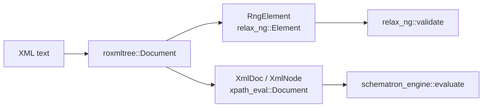

`relax-ng`, `xpath-eval` and `schematron-engine` take documents through traits and parse none
themselves. This crate implements those traits for `roxmltree`, so a host that has XML text
validates it against a RELAX NG and a Schematron schema without writing the glue first. It sits
in L1 because it knows the L0 traits; the L0 crates do not know it (rule "no host format in the
core"), apart from a dev-dependency of `xpath-eval`'s tests.

## Status

0.1.0, not yet published. The first version of a new crate has to be published by hand (see
[Releases](../releasing.md)). Only `roxmltree`; other trees (`xmltree`, `quick-xml` DOMs) are
open under casoon/barrierlab#75.

## Structure

## Public surface

- `RngElement` (feature `relax-ng`): `relax_ng::Element` over a `roxmltree` element. Text is
  merged across comments and processing instructions, `xmlns` declarations are not attributes,
  bindings in scope (inherited too) serve `QName` values.
- `XmlDoc`, `XmlNode` (feature `xpath`): an arena copy of the tree in document order implementing
  `xpath_eval::Document` and `Node`. Namespace axis with the implicit `xml` node, attribute nodes,
  comments, processing instructions, empty namespace URI as "none", `xml:id` as ID attribute.
  `XmlDoc::parse(&str)` or `XmlDoc::from_roxmltree(&Document)` for other parser options.
- `Position`: line and column from 1, byte offset from 0. It is the `Location` of `RngElement`
  (so a `relax_ng::ValidationError` carries it) and `XmlNode::position()` (so a Schematron
  `Report::node` has it).

## Limits

- `roxmltree` exposes no DTD attribute types, so `id()` finds `xml:id` only.
- Positions are those of the start tag's `<`; text, attribute and comment nodes have none.
- `xpath-eval`'s own tests use `XmlDoc` through a path-only dev-dependency that loops back to
  `xpath-eval`. Cargo allows this for dev-dependencies and drops the entry when packaging; the
  packaged tests of `xpath-eval` therefore do not build outside this repository.

## Verification

`crates/xml-adapters/tests/validate.rs`: one document against an RNG and a Schematron schema
(valid, invalid, positions), the namespace axis, comments, processing instructions, `xml:id` and
document order, plus the README example as a doctest. The Jaxen and regression suites of
`xpath-eval` run over this adapter.
